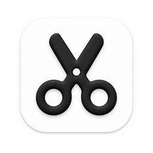

<p align="center">
  <a href="README.md">English</a> · <a href="README-CN.md">中文文档</a>
</p>

<p align="center">
  
</p>

<h1 align="center">MacClippy</h1>

<p align="center">
  <strong>专为 macOS 打造的原生剪贴板管理器。</strong><br>
  使用 Swift、AppKit、SQLite FTS5 搜索、本地 Vision OCR 与剪贴板内容加密。
</p>

<p align="center">
  <a href="https://github.com/wangm12/mac-clippy/releases/tag/nightly"></a>
  <a href="https://github.com/wangm12/mac-clippy/releases"></a>
  
  
  
</p>

---

## 产品简介

macOS 剪贴板保存当前内容。复制新内容后，之前的内容会被替换。

**MacClippy** 是一款 macOS 原生剪贴板管理器，可采集受支持的剪贴板表示形式，在本机保存可搜索的历史记录，并提供固定板、快捷片段和粘贴工具。

MacClippy 将剪贴板观察和存储设计为本地操作。实际响应速度和资源占用会随 Mac、macOS 版本和历史数据而变化；本文不提供与其他产品的性能对比数据。

---

## 核心功能特性

### 🎨 液态毛玻璃悬浮坞 (Liquid Glass Dock)
- **原生悬浮坞**：按 **`⌘⇧V`**（可自定义）或点击菜单栏图标唤出。使用 macOS 原生材质，并支持多显示器和全屏空间。
- **多显示器与全屏智能吸附**：精准感知当前鼠标所在的活动屏幕与全屏应用（Full Screen Spaces），自动避开系统 Dock 栏与菜单栏，支持多屏无缝流转。
- **浅色与深色模式自适应**：动态适配 macOS 系统的深色、浅色模式与壁纸强调色。

### ⚡ 全类型无损高保真采集
- **全媒体格式覆盖**：自动保存纯文本、富文本 (RTF)、HTML 代码、高分辨率图片（PNG、JPEG、TIFF）、文件/文件夹引用、网页 URL 以及十六进制色值色块。
- **来源应用高精度标识**：每张历史卡片均展示来源 App 的高分辨率矢量图标及应用名称，便于快速识别回溯。
- **苹果通用剪贴板 (Universal Clipboard)**：可采集 Apple 通用剪贴板放到本机剪贴板上的内容。这是 macOS 的系统功能，不会同步 MacClippy 历史或加密密钥。

### 🔍 SQLite FTS5 & 中日韩 (CJK) 检索
- **全文索引搜索**：使用 SQLite FTS5 全文索引和 GRDB WAL 模式。
- **中日韩文字与前缀支持**：完美分词支持中文、日文、韩文连续字串检索，支持英文前缀匹配（如 `clip*`）与精确双引号匹配（`"精确词组"`）。
- **高级语法过滤器**：支持类型过滤（`type:text`、`type:image`、`type:url`、`type:files`）、来源应用过滤（`app:Xcode`、`app:微信`）、条目命名（`name:`）以及 OCR 状态（`has:ocr`）。

### 👁️ 本地设备端 Apple Vision OCR 识别
- **本地文字提取**：使用 macOS Vision 框架识别复制图片中的文字。
- **搜索图片文字**：截图中的代码、单号和报错文字可加入全文检索。
- **实况文本框选**：在悬浮坞预览图片即可直接鼠标划词、复制提取图片内文本，隐私零外泄。

### 📌 标签分类固定板 (Pinboards) 与快捷片段
- **多彩固定板**：可为常用代码、邮件回复模版、临时 Token 或设计素材创建不同颜色主题的 Pinboard 分类，拖拽即可整理。
- **永久留存**：固定板内容独立保存，不会随日常剪贴历史的滚动而被冲刷遗忘。
- **片段快速展开 (Snippets)**：逐字输入 `;trigger` 后按空格展开，也可在设置中选择 **Confirm with Tab** 后按 Tab 确认。请使用英文分号 `;`，复制粘贴整串不会触发。回车不触发展开。

### 🪄 实时文本格式变换工具 (Transforms)
- **粘贴前快速整形**：在悬浮坞内一键转换文本格式再行粘贴：
  - **大小写与命名规范**：大写、小写、词首大写、`camelCase`、`snake_case`、`kebab-case`。
  - **文本整理**：去除首尾空白、合并多余空行换行、剔除 Markdown/HTML 标签。
  - **开发者利器**：JSON 格式化 / 紧凑压缩、URL 编码 / 解码、Base64 快速编解码。

### 📋 多模式强力粘贴 (Power Paste)
- **直接粘贴**：在结果中按 `Return`，将选中内容粘贴到前台工作窗口。双击卡片复制并关闭面板；`⌘C` 复制且保持面板打开。
- **纯文本格式粘贴**：使用 `⇧⏎` (Shift+Return) 切换纯文本与原格式。启用“始终粘贴为纯文本”时，Shift-Return 恢复原格式。
- **连续队列粘贴 (Queue Paste)**：多选卡片后，在“更多”中选择连续粘贴所选项，按屏幕显示顺序粘贴到同一个目标；不会自动切换表单字段，也没有“粘贴下一项”快捷键。
- **多卡片组合粘贴**：按住 `⌘` 或 `Shift` 点击多张卡片，一键批量组合粘贴。
- **原生快速查看 (Quick Look)**：按空格键 `Space` 展开大图查看、放大高清细节与进行 OCR 划词。

### 🛡️ 本地隐私与加密
- **加密内容载荷**：剪贴板载荷信封和本地附件/图片载荷使用 AES-256-GCM 加密，密钥为 256 位软件密钥，存储在 macOS Data Protection Keychain 中，并标记为仅限本设备使用；这不是 Secure Enclave 密钥。
- **密码管理器智能过滤**：默认严格拦截来自 1Password、Bitwarden、KeePassXC、苹果密码、钥匙串访问等敏感安全软件的内容，且自动忽略系统标记为隐藏或临时的数据类型。
- **自定义黑名单**：支持在偏好设置中添加需要屏蔽采集的应用或正则敏感规则。
- **没有 MacClippy 云端同步**：MacClippy 不提供账号式历史记录同步服务。

---

## 性能与容量

MacClippy 使用原生 Swift/AppKit 组件和 SQLite FTS5 索引。仓库包含回归和规模测试夹具，但这不等于已发布延迟、内存、CPU 或跨产品基准数据。本文没有发布数值性能目标或实测结果，也不提供启动时间、RSS、搜索延迟或动画帧率对比。

剪贴板观察在活跃使用期间以及检测到剪贴板变化后的短暂窗口内，约每 50 毫秒轮询一次。若约 30 秒没有用户输入或近期剪贴板变化，间隔会调整为约 400 毫秒。系统睡眠时会暂停轮询。

历史记录同时受保留时间、条目数量和载荷容量限制：

- 默认最多保留 **10,000** 条。
- 所有保留图片载荷共用 **2 GiB** 容量上限；这不是单张图片上限。
- 所有剪贴板载荷合计上限为 **4 GiB**。
- **不限时**只表示不按年龄自动过期，条目数和载荷容量限制仍然生效。SQLite 元数据、索引、日志和文件系统开销不计入这些载荷预算，因此它们不是整个应用支持目录的严格磁盘空间上限。

参见[基于一手来源的竞品行为比较与工程建议](docs/competitive-comparison.md)。

---

## 常用快捷键一览

| 快捷键 | 功能说明 |
|---|---|
| **`⌘ ⇧ V`** | 唤出或收起 MacClippy 悬浮卡片坞（可在偏好设置中修改） |
| **`直接打字`** | 即刻对所有历史记录进行模糊匹配与全文检索 |
| **`⏎` (Return)** | 搜索框内进入结果，结果中粘贴选中项 |
| **`⇧ ⏎`** | 切换纯文本与原格式粘贴 |
| **`空格 Space`** | 在结果中开关预览，在搜索框中正常输入空格 |
| **`⌘ 1` – `⌘ 9`** | 快速粘贴对应序号的剪贴项 |
| **`⌘ C`** | 将选中卡片拷贝到系统剪贴板（不关闭卡片坞） |
| **`⌘ P`** | 为选中条目选择目标固定板 |
| **`Tab` / `Shift-Tab`** | 在搜索框和结果之间切换，保留查询 |
| **`⌘ F` / `⌘ K`** | 聚焦搜索框 |
| **`⌘ ⌥ V`** | 查看条目详情，在详情中按 `⌘E` 编辑 |
| **`⌘ S` / `⌘ Return`** | 编辑时保存／保存并粘贴 |
| **`⌘ ⌫` (退格)** | 从历史记录中彻底删除该条内容 |
| **`←` / `→`** | 在剪贴板卡片之间左右切换选择 |
| **`Esc`** | 分层退出；搜索中先清查询，再关闭卡片坞 |

---

搜索和筛选在选中卡片、预览或编辑时保持不变。搜索旁的筛选按钮可选择类型、来源应用和日期。切到片段时只使用关键词，返回历史会恢复筛选条件。搜索框 × 清空关键词与筛选，“清除筛选”只移除条件。

## 搜索语法与过滤指令

MacClippy 顶部搜索框支持自然关键词检索以及精准过滤指令：

- **普通文字与中文连续串**：`git commit`、`设计稿`、`需求文档`
- **双引号精确匹配**：`"API_KEY_PRODUCTION"`、`"会议纪要"`
- **通配符前缀匹配**：`clip*`、`func*`
- **类型限定指令**：
  - `type:text` — 仅筛选纯文本与富文本
  - `type:image` — 仅筛选截图、照片与图形文件
  - `type:url` — 仅筛选网址与网页链接
  - `type:files` — 仅筛选复制的文件或文件夹路径
- **来源应用限定**：`app:Xcode`、`app:Slack`、`app:Safari`、`app:微信`
- **命名匹配**：`name:常用欢迎语`
- **图片文字识别限定**：`has:ocr` — 仅筛选包含可识别文本的图片
- **复合组合查询**：`报错 type:text app:Terminal`

---

## 苹果通用剪贴板 (Universal Clipboard)

如果 macOS 通用剪贴板把附近 Apple 设备复制的内容放到本机剪贴板，MacClippy 可以将其保存为本地历史记录。MacClippy 不会在不同 Mac 之间同步历史记录或加密密钥。

备份包含加密后的应用数据，但不会导出钥匙串密钥。恢复数据需要原安装仍保有的密钥；备份不能把历史记录或密钥迁移到另一台设备。

---

## 下载与安装指南

### 1. 下载官方预编译安装包
`main` 分支会生成每日构建，`vX.Y.Z` 标签会生成正式版本；两者都必须先通过同一提交 SHA 的 CI 检查：

- **下载 DMG 或 ZIP 发布包**：
  - [正式发布页面 Releases](https://github.com/wangm12/mac-clippy/releases)（稳定发布版本）
  - [每日构建页面 Nightly](https://github.com/wangm12/mac-clippy/releases/tag/nightly)（最新持续集成包）
- 从发布页面选择带版本号的 DMG 或 ZIP。打开 DMG 后，将 `MacClippy.app` 拖入 **Applications（应用程序）** 文件夹。

### 2. 权限授予与 Gatekeeper 说明
- **辅助功能权限 (Accessibility)**：用于实现自动回车注入粘贴（通过 `CGEvent` 键鼠模拟）与文本快速展开。请在 **系统设置 → 隐私与安全性 → 辅助功能** 中勾选允许。
- **Gatekeeper 首次打开提示**：未使用 Developer ID 签名和公证的构建可能触发 Gatekeeper 警告。
  - 先尝试打开应用，然后前往 **系统设置 → 隐私与安全性** 选择 **“仍要打开”**，再确认提示。参见[Apple 官方说明](https://support.apple.com/zh-cn/102445)。

### 3. 从源码构建

系统环境要求：
- 应用运行环境：macOS 14.0 或更高版本（Sonoma 或更新版本）
- 源码构建环境：Xcode 16.3+、Swift 6.1+，并使用该 Xcode 支持的 macOS 版本
- [XcodeGen](https://github.com/yonaskolb/XcodeGen) 与 [SwiftLint](https://github.com/realm/SwiftLint)（工程内脚本会自动安装固定版本）

```sh
# 克隆代码仓库
git clone https://github.com/wangm12/mac-clippy.git
cd mac-clippy

# 安装指定版本工具链 (XcodeGen 与 SwiftLint)
./scripts/install-pinned-tools.sh

# 生成 Xcode 工程文件
make generate

# 编译 Debug 版本
make build

# 打包 DMG 与 ZIP 到 dist/ 目录（配置 Developer ID 证书后才会签名）
make dmg
```

---

## 开发与测试常用命令

参见 [CI 与发布流程说明](docs/release-process.md)，了解同一提交的发布门禁、版本规则和最低系统运行测试。

```sh
make help           # 列出可用的开发与发布目标
make generate       # 从 project.yml 重新生成 MacClippy.xcodeproj
make build          # 编译 Debug 应用程序
make test           # 运行 Package 测试和 MacClippyTests 单元测试；不运行 UI 测试
make test-scripts   # 运行构建与发布脚本测试
make test-scale     # 显式启用 Package 与 Runtime 规模测试夹具
make test-stress    # 运行生命周期压力测试
make test-tsan      # 使用 Thread Sanitizer 运行 Package 测试
make test-app-tsan  # 使用 Thread Sanitizer 运行 MacClippyTests 单元测试
make lint           # 依据基准线执行 SwiftLint 代码质量检查
make dmg            # 打包 DMG 与 ZIP（配置 Developer ID 证书后才会签名）
make ci             # 运行 CI 构建和验证流程
make clean          # 清理受管理的缓存、测试结果和归档；保留 dist/ 与审查证据
```

---

## 架构与技术栈设计

```text
MacClippy/
├── MacClippy/             # 原生 AppKit 界面层、液态毛玻璃卡片坞、状态栏与偏好设置
├── MacClippyKit/          # 核心底层库：存储层、FTS5 检索、OCR 引擎、文本变换、加密
├── MacClippyTests/        # 应用程序级 XCTest 单元与集成测试
├── MacClippyUITests/      # 界面动效交互、卡片拖拽与粘贴模拟自动化测试
├── scripts/               # 证书自签名、DMG/ZIP 打包封装与环境验证脚本
└── project.yml            # 声明式 XcodeGen 工程管理定义
```

- **图形界面**：基于原生 AppKit 定制 `NSPanel`、`NSVisualEffectView`、Core Animation 硬件加速渲染与拖拽交互。
- **持久化存储**：SQLite 3 结合 WAL 日志模式，通过现代 Swift 数据库框架 [GRDB.swift](https://github.com/groue/GRDB.swift) 进行高效异步操作。
- **全文检索引擎**：SQLite FTS5 引擎，结合定制 Unicode 分词器及 CJK 连续字串匹配算法。
- **OCR 识别引擎**：使用 Apple Vision 框架 (`VNRecognizeTextRequest`) 在设备本地识别文字。
- **载荷加密**：CryptoKit AES-256-GCM 使用软件生成的 256 位密钥；密钥存放于 Data Protection Keychain，并设置为 `WhenUnlockedThisDeviceOnly`。这不是 Secure Enclave 密钥。

---

## 隐私与数据安全说明

MacClippy 将数据保存在本地 Mac：

```text
~/Library/Application Support/MacClippy/
```

- MacClippy 没有账号式历史记录同步。Apple 通用剪贴板可以把复制内容放到本机剪贴板，MacClippy 随后在本机保存副本。
- 剪贴板载荷信封和附件/图片载荷字节会加密。SQLite 数据库本身并未整体加密：可搜索预览、OCR 文字、全文索引词、自定义标签和片段触发词、来源应用信息、内容类型、时间戳及其他运行元数据以明文保留，以支持搜索和展示。
- 加密密钥保存在当前安装的钥匙串中，不包含在备份里。恢复数据需要原安装的密钥；备份不提供跨设备密钥迁移。
- 系统级敏感情报（密码框拷贝、临时复制数据、标记为隐私的数据类型）会在落盘前直接丢弃。
- 随时在设置面板中点击一键清空全部历史记录。

---

## 开源协议

本项目尚未发布公开许可证。
